<picture>
  <source media="(prefers-color-scheme: dark)" srcset="assets/banner-dark.svg">
  
</picture>

I build software end to end with AI at the core: MCP servers, agent tooling and
production integrations for real businesses. Based in Buenos Aires, Argentina.

### Building

- **[ArcaMCP](https://github.com/Yoryoboy/ArcaMCP)** — MCP server for Argentina's AFIP/ARCA: certificates, web service auth, invoicing and PDF with QR.
- **E-commerce BI over MCP** — one MCP layer for VTEX, Mercado Libre, Mercado Pago, GA4, Ads and more, with an admin dashboard *(private, in production)*.
- **[ai-ugc-commerce-studio](https://github.com/Yoryoboy/ai-ugc-commerce-studio)** — Claude plugin that turns e-commerce products into AI UGC videos.
- **Agent tooling** — [Codex](https://github.com/Yoryoboy/pi-multi-auth-codex) and [Claude](https://github.com/Yoryoboy/pi-multi-auth-claude-bridge) multi-account rotation for the Pi coding agent, and a [Whisper-compatible bridge](https://github.com/Yoryoboy/assemblyai-whisper-bridge) for AssemblyAI.

### Recently

<!-- RECENT:START -->
- [**ai-ugc-commerce-studio**](https://github.com/Yoryoboy/ai-ugc-commerce-studio) · updated · Nov 25, 2026
- [**ArcaMCP**](https://github.com/Yoryoboy/ArcaMCP) · updated · Nov 2, 2026
- [**connectif-mcp**](https://github.com/Yoryoboy/connectif-mcp) · updated · Oct 23, 2026
- [**ghostlink**](https://github.com/Yoryoboy/ghostlink) · updated · Oct 16, 2026
- [**pi-multi-auth-claude-bridge**](https://github.com/Yoryoboy/pi-multi-auth-claude-bridge) · updated · Oct 14, 2026
<!-- RECENT:END -->

### Stack

TypeScript · Go · Rust · Python · Node.js · React · MCP · Playwright · Docker

[LinkedIn](https://www.linkedin.com/in/93jads/) · [X](https://x.com/jgeorgie_boy) · [Email](mailto:93jads@gmail.com)
